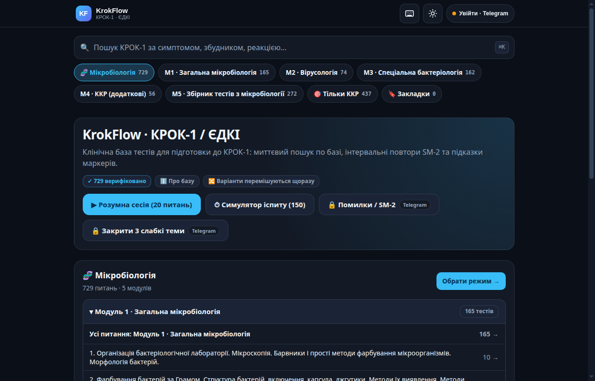

# KrokFlow

[](https://github.com/razin-core/krokflow/actions/workflows/ci.yml)

Public web platform for Ukrainian medical students preparing for **KROK-1 / ЄДКІ** exams.

- **Live Demo:** https://krokflow.pp.ua (Guest mode + Telegram Login Widget)
- **Stack:** Python 3.12 · FastAPI · SQLite (`WAL` + `FTS5`) · Vanilla JS (`Dark / Light` responsive UI) · `pytest` · Playwright QA

## Key Features
- **Positional PDF & `.doc` Importer (`importer/krok_importer.py`):** splits glued answer options, deduplicates stems, and isolates malformed/ambiguous records into a `needs_review` quarantine instead of polluting the verified pool.
- **Fast `FTS5` Search (`app/services/search_service.py`):** normalizes Cyrillic/Latin `і/i` homoglyphs from legacy medical PDFs and filters out distractor-only option matches so results match either the question stem or the verified correct answer.
- **Spaced Repetition (`SM-2`):** per-user progress tracking, smart review queues, and weakest-topic targeting (`app/services/sm2_service.py`).
- **Pre-cached Explanations & Markers (`scripts/pregenerate_explanations.py`):** batch pre-generation into SQLite so user quiz sessions incur zero runtime LLM quota burn.
- **Telegram Login Widget Auth (`app/services/auth_service.py`):** `HMAC-SHA256` verification with signed `HttpOnly` session cookies and seamless guest-to-account transition.

## Local Run & Tests
```bash
python3 -m venv .venv
source .venv/bin/activate
pip install -r requirements.txt
cp .env.example .env
pytest -q
uvicorn app.main:app --host 127.0.0.1 --port 8780
```

> Note: Production question databases (`data/krok.db`), environment secrets (`.env`), and tunnel configs are intentionally excluded from this repository.


## Interface Preview

| Home & Topic Explorer | Topic Filters & Mode Selection |
| :---: | :---: |
|  |  |
