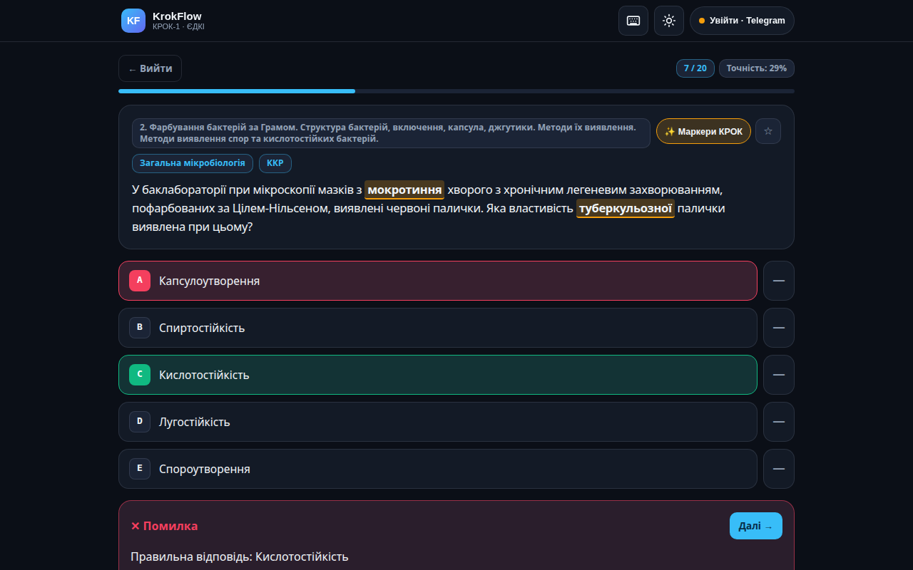

# KrokFlow

[](https://github.com/razin-core/krokflow/actions/workflows/ci.yml)

Public web platform for Ukrainian medical students preparing for **KROK-1 / ЄДКІ** exams (`v2.8.0`).

- **Live:** https://krokflow.pp.ua (Guest mode + Telegram Login Widget + installable PWA manifest)
- **Bank:** **2,570 verified questions** across 3 KROK-1 subjects — **Мікробіологія** (`729`), **Фармакологія** (`1,211`), **Патоморфологія** (`630`)
- **Stack:** Python 3.12 · FastAPI · SQLite (`WAL` + `FTS5`) · Vanilla JS (`Dark / Light` responsive UI) · `pytest` · Playwright QA

## Key Features
- **Cascade Topic & Booklet Constructor (`static/js/cascade_selector.js`):** multi-topic and KROK booklet year filtering paired with configurable **total session timer** (`t_total`) and **per-question timer** (`t_q`, auto-advance without credit on timeout).
- **Deterministic Offline KROK Triggers (`app/services/explain_service.py`, `scripts/pregenerate_explanations.py`):** subject-aware `trigger-index-v1` clinical anchors and verbatim stem highlights across Microbiology, Pharmacology, and Pathomorphology with zero runtime LLM API spend.
- **Spaced Repetition & Analytics Reset (`app/services/sm2_service.py`):** `SM-2` interval scheduling, weakest-topic closure, flashcards, and user-isolated analytics reset (`POST /api/v1/stats/reset`) with optional bookmark preservation.
- **Positional PDF & `.doc` Importer (`importer/krok_importer.py`):** splits glued options, normalizes homoglyphs, deduplicates stems, and quarantines malformed items under `needs_review`.
- **Fast `FTS5` Search (`app/services/search_service.py`):** normalizes Cyrillic/Latin `і/i` homoglyphs and filters distractor-only matches so hits match stems or verified answers.
- **Error Reporting (`question_reports`) & Rate Limiting:** in-card modal reporting (`POST /api/v1/questions/{qid}/report`) for keys, typos, and duplicates with duplicate suppression and IP sliding-window limits.
- **Telegram Auth & Installable PWA (`manifest.json`):** `HMAC-SHA256` Login Widget sessions plus Web App Manifest and branded PNG icons without caching Service Workers so assets never go stale on mobile.
- **Automated Daily SQLite Hot Backups (`scripts/backup_db.sh`):** `systemd --user` timer (`krok-backup.timer`) runs `sqlite3 .backup` + `PRAGMA quick_check` daily with 7-dump rotation.

## Local Run & Tests
```bash
python3 -m venv .venv
source .venv/bin/activate
pip install -r requirements.txt
cp .env.example .env
node --check static/js/*.js
pytest -v tests/
uvicorn app.main:app --host 127.0.0.1 --port 8780
```

> Note: Production databases (`data/krok.db`, backups), secrets (`.env`, `.token_secret`), and tunnel configs (`.cloudflared.env`) are excluded from version control.

## Interface Preview

| Home & Topic Explorer | Topic Filters & Mode Selection |
| :---: | :---: |
|  |  |
